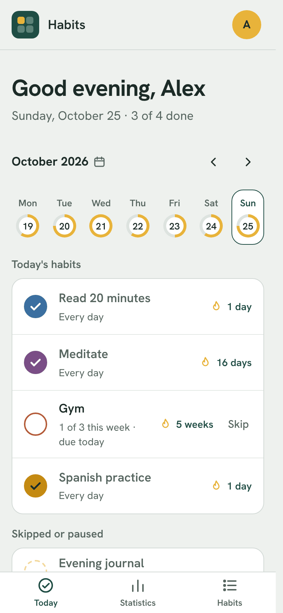
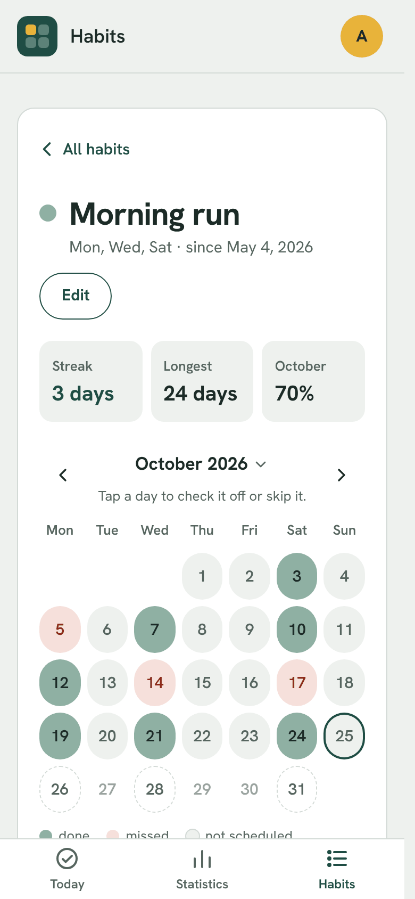
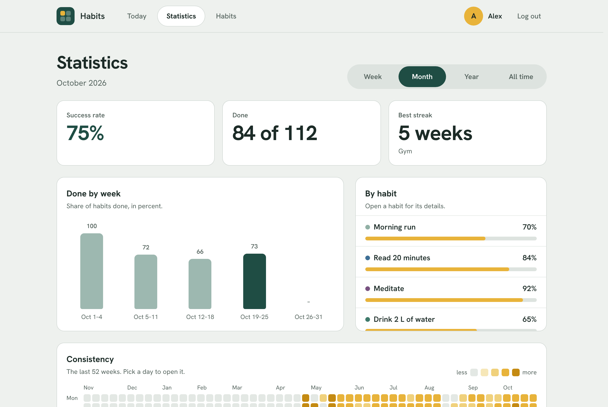

# Habits

[](https://github.com/petrjancar/habits/actions/workflows/ci.yml)
[](https://opensource.org/licenses/MIT)
[](https://ko-fi.com/petrjancar)

A small self-hosted habit tracker: check off habits each day, keep streaks going and see how consistent you've been. A [PocketBase](https://pocketbase.io) backend with an [Alpine.js](https://alpinejs.dev) + [Tailwind CSS](https://tailwindcss.com) frontend, served by PocketBase from a single process or Docker container.

<p>
  
  
</p>



## Features

- **Today** - check off today's habits or any earlier day, page through the weeks, jump to any date with a calendar, and see what's scheduled ahead.
- **Habits** - add, edit, reorder, archive, reset and delete habits, in 16 colours. Every habit has a calendar of any month with its streaks, where you can check off or skip a day.
- **Schedules** - every day, chosen weekdays, or a number of times per week.
- **Pauses and skips** - pause a habit now or plan a pause ahead (a holiday, for one habit or all), and skip a single day ("sick day") without breaking the streak.
- **Statistics** - success rate, best streak, charts and a 52-week calendar for a week, month, year or all time.
- **Light and dark theme** - pick one, or follow the device's setting.
- **Account** - first day of the week, backup export and import (JSON), account deletion.
- **Installable** - on a phone's home screen as a progressive web app (PWA), and works on desktop too.

How streaks are counted and the backup format are in [docs/how-it-works.md](docs/how-it-works.md).

What is stored and logged is in [docs/privacy.md](docs/privacy.md).

## Deploy

You need Docker with Compose. For anything beyond your own network, and to install the app on a phone as a PWA, you also want HTTPS (see below).

1. Create a folder for the app and its database.

   ```bash
   mkdir habits && cd habits && mkdir -p pb_data
   ```

2. Create `docker-compose.yml` in it and set the admin email and password.

   ```yaml
   services:
     habits:
       image: ghcr.io/petrjancar/habits:2
       container_name: habits
       restart: unless-stopped
       ports:
         - "8090:8090"
       environment:
         PB_ADMIN_EMAIL: you@example.com
         PB_ADMIN_PASSWORD: change-me-at-least-8-chars
       volumes:
         - ./pb_data:/pb/pb_data
   ```

3. Start it and open `http://localhost:8090` (or the server's address with port `8090`). The dashboard is at `/_/`.

   ```bash
   docker compose up -d
   ```

### Updating

```bash
docker compose pull && docker compose up -d
```

The `:2` tag follows the latest 2.x release, so this picks up new features and fixes, and any database changes are applied when the container starts. A new major version (`:3`) can need something from you, so it's never pulled automatically: read its entry in [CHANGELOG.md](CHANGELOG.md) before changing the tag. To stay on an exact version, use its full tag, such as `:2.0.0`.

### Backups

Everything is in `pb_data`. Back it up by stopping the container and copying the folder, or with the backups in the PocketBase dashboard (Settings → Backups), which can also go to S3-compatible storage. Each user can also download their own habits as a JSON file from the Account page and import it again on any Habits server.

### HTTPS and reverse proxy

Browsers only allow installing the app on a phone over HTTPS, and passwords should not travel over plain HTTP outside your own network. Put a reverse proxy that provides HTTPS (Nginx Proxy Manager, Caddy, Traefik, ...) in front of the app and forward to port `8090`.

## Develop

You need Node.js 24 and the PocketBase binary for your OS (version in the `Dockerfile`) in the project root.

```bash
cd frontend && npm install
./pocketbase serve         # in the project root, second terminal (pocketbase.exe on Windows)
npm run dev                # in frontend/, then open http://localhost:5173
```

More in [docs/development.md](docs/development.md): project structure, how the frontend works, the data model, schema changes and dependency updates.
